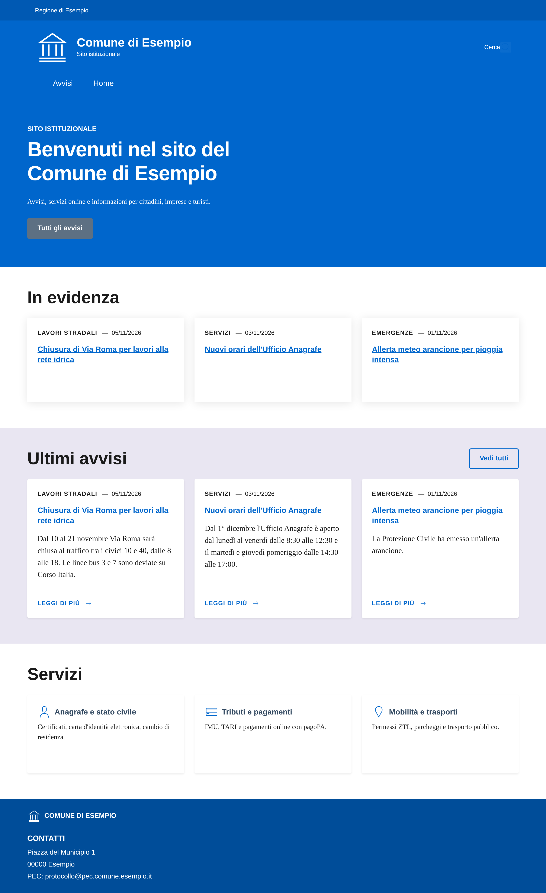
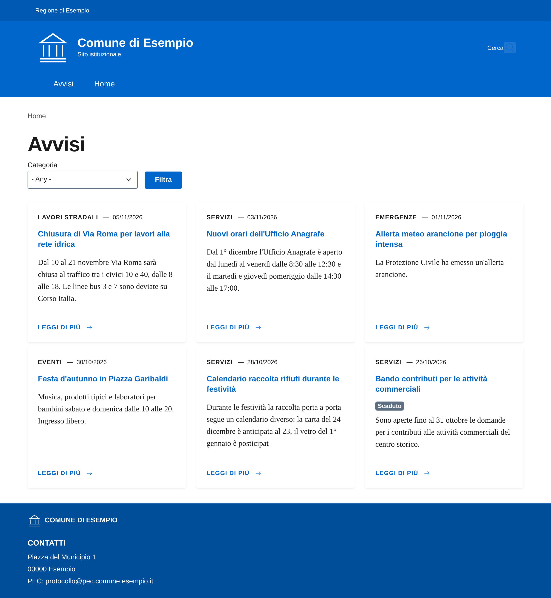
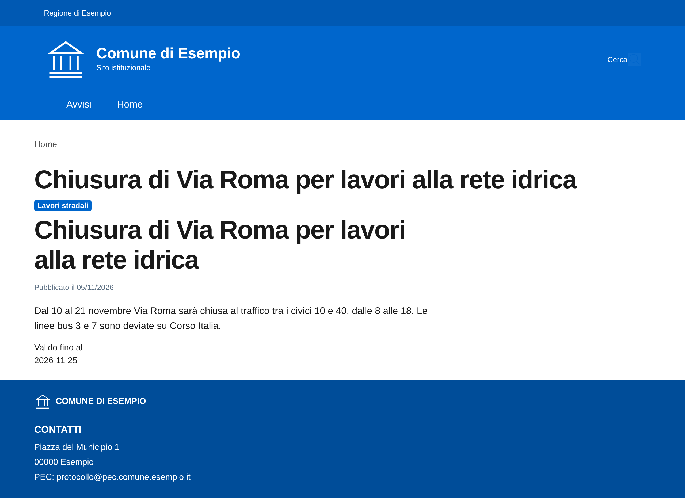
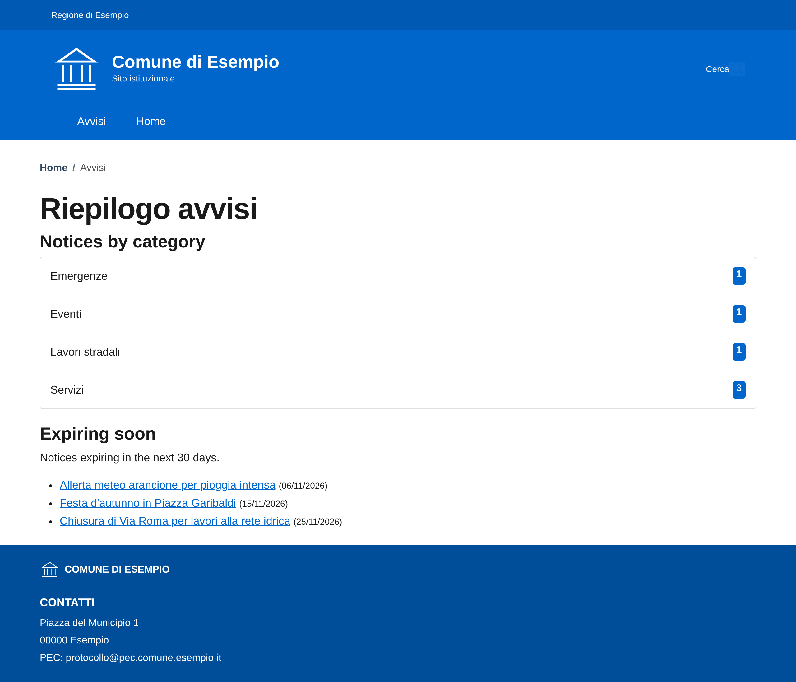
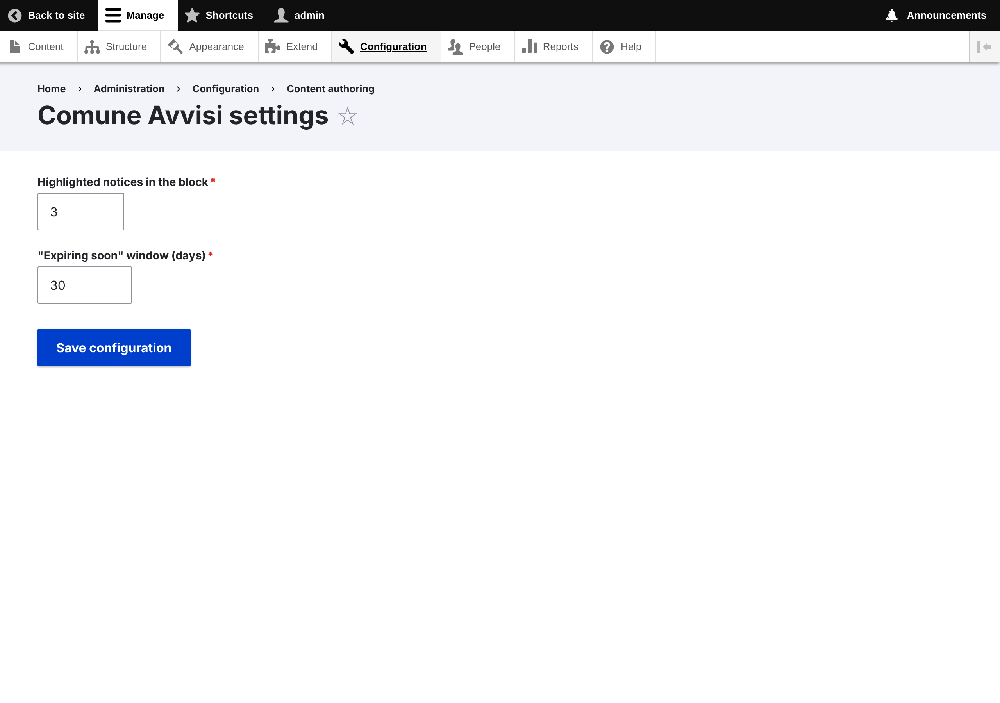

# drupal10 — Municipal website with Bootstrap Italia

A small Drupal 10 site for a fictional town hall (*Comune di Esempio*),
built like the "modello Comuni" from [Designers Italia](https://designers.italia.it/modelli/comuni/):
a home page with highlighted notices, a filterable **Avvisi** list, a custom
module and a custom theme based on [Bootstrap Italia](https://italia.github.io/bootstrap-italia/).



## Purpose

Prepare for working on Drupal 9/10 municipal sites: content modelling, Views,
blocks, a custom module (routing, controller, services and dependency
injection, configuration form, block plugin), a custom Twig theme, the
configuration management workflow and the 9 → 10 upgrade process.

## Tech stack

- Drupal 10.6, PHP 8.3, Drush 13
- Bootstrap Italia 2.13 (installed with npm in the theme, no CDN)
- PHP_CodeSniffer with the **Drupal** and **DrupalPractice** standards (`drupal/coder`)
- DDEV (MariaDB 10.11)

## What is in git (and what is not)

| Committed | Not committed (rebuilt) |
|---|---|
| `composer.json`, `composer.lock` | `vendor/`, `web/core/`, contrib modules/themes |
| `web/modules/custom/comune_avvisi` | `web/sites/*/files/` (uploads, CSS/JS aggregates) |
| `web/themes/custom/comune_theme` (+ `package.json`) | theme `node_modules/` |
| `config/sync/` (all site configuration) | database, `settings.local.php`, `settings.ddev.php` |
| `web/sites/default/settings.php` (no secrets) | |

## Run it

```bash
cd drupal10
ddev start
ddev composer install
ddev exec "cd web/themes/custom/comune_theme && npm ci"

# Install Drupal, then import the committed configuration
ddev drush site:install standard --account-pass=admin -y
ddev drush config:set system.site uuid "$(grep '^uuid' config/sync/system.site.yml | cut -d' ' -f2)" -y
ddev drush entity:delete shortcut_set -y
ddev drush config:import -y

# Example content (content is not configuration)
ddev drush php:script scripts/demo-content.php
ddev launch               # admin login: ddev drush uli
```

> Why the uuid step? Drupal only imports config that belongs to the same
> site. A fresh install gets a new uuid, so we set it to the one in
> `config/sync`. The `standard` profile has a `hook_install()`, which is why
> `site:install --existing-config` cannot be used with it.

Code style: `ddev exec vendor/bin/phpcs` (config in `phpcs.xml.dist`).

## Tour of the code

### Content model (site building)

- **Content type** `avviso` with body, `field_categoria` (taxonomy reference),
  `field_scadenza` (date "valid until"), `field_in_evidenza` (boolean).
- **Taxonomy** `categorie_avvisi`: Lavori stradali, Eventi, Servizi, Emergenze.
- **View** `avvisi`: page `/avvisi` (cards, exposed category filter, pager)
  and block "Ultimi avvisi" (3 items) for the home page.
- **Blocks** placed in the theme regions (`block.block.comune_theme_*`).

The content type and fields ship with the module (`config/install`), so the
module is reusable; the view and blocks are site config in `config/sync`.

### Custom module `comune_avvisi`

| File | Concept |
|---|---|
| `comune_avvisi.info.yml` | Module definition, dependencies, `core_version_requirement` |
| `comune_avvisi.routing.yml` | Routes → controller / form, with permissions |
| `comune_avvisi.services.yml` + `src/AvvisiRepository.php` | A service with injected dependencies (entity type manager, time, config) |
| `src/Controller/AvvisiController.php` | `ControllerBase` + `create()` for DI, returns a cacheable render array |
| `src/Form/SettingsForm.php` + `config/schema` | `ConfigFormBase`: settings stored as exportable config |
| `src/Plugin/Block/HighlightedAvvisiBlock.php` | Block plugin with PHP attribute discovery and `ContainerFactoryPluginInterface` |
| `comune_avvisi.module` | `hook_help()`, `hook_theme()` |
| `comune_avvisi.install` | `hook_install()`: body field, form/view displays, default terms |
| `templates/*.html.twig` | Module templates (auto-escaped Twig) |

### Custom theme `comune_theme`

| File | Concept |
|---|---|
| `comune_theme.info.yml` | Base theme `stable9`, regions, global library |
| `comune_theme.libraries.yml` | Bootstrap Italia CSS/JS served locally + custom CSS |
| `comune_theme.theme` | `hook_preprocess_page()`, `hook_preprocess_node()`, `hook_page_attachments_alter()` |
| `templates/layout/page--front.html.twig` | Home: hero, *In evidenza*, *Ultimi avvisi*, *Servizi* |
| `templates/layout/_header.html.twig` | BI header: slim bar (ente), brand, search, navbar |
| `templates/content/node--avviso--teaser.html.twig` | Notice as a BI card |
| `templates/navigation/menu--main.html.twig`, `breadcrumb.html.twig` | Accessible nav with `aria-current` |

### Configuration management

```bash
drush cex   # DB → config/sync (commit the YAML)
drush cim   # config/sync → DB (deploy)
drush cst   # show differences
drush cr    # rebuild caches
drush updb  # run database updates after code updates
```

Rule of thumb: **configuration** (content types, fields, views, blocks,
settings) travels through git; **content** (nodes, terms, users) stays in the
database of each environment.

## More docs

- [Drupal 9 → 10 upgrade process](docs/upgrade-9-to-10.md): Upgrade Status, Drupal Rector, Composer, CKEditor 5
- [Accessibility basics (WCAG 2.1 AA)](docs/accessibility.md)

## Screenshots

| Avvisi list | Notice | Summary page (module) | Settings form (module) |
|---|---|---|---|
|  |  |  |  |

## What I learned

- Drupal separates **code** (modules/themes), **configuration** (YAML in git)
  and **content** (database) — and the deploy workflow follows that split.
- Services + dependency injection make custom code testable, just like in
  .NET or Laravel; `\Drupal::service()` is only for procedural code.
- Render arrays + cache tags (`node_list`, `config:…`) let Drupal cache pages
  and still invalidate them when content changes.
- Bootstrap Italia gives accessible components, but semantic markup, labels
  and focus order are still my job.
