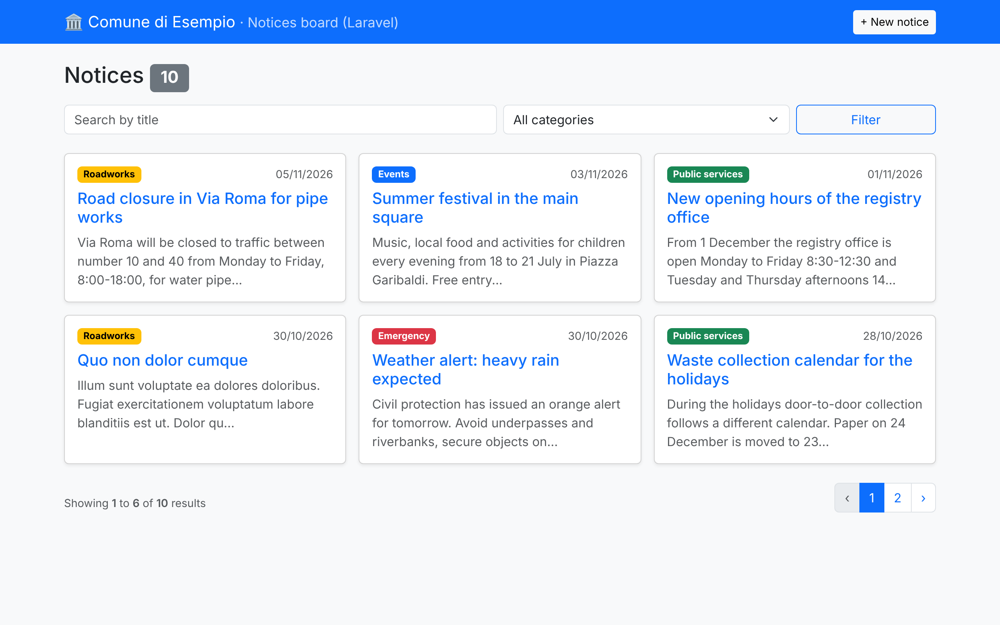
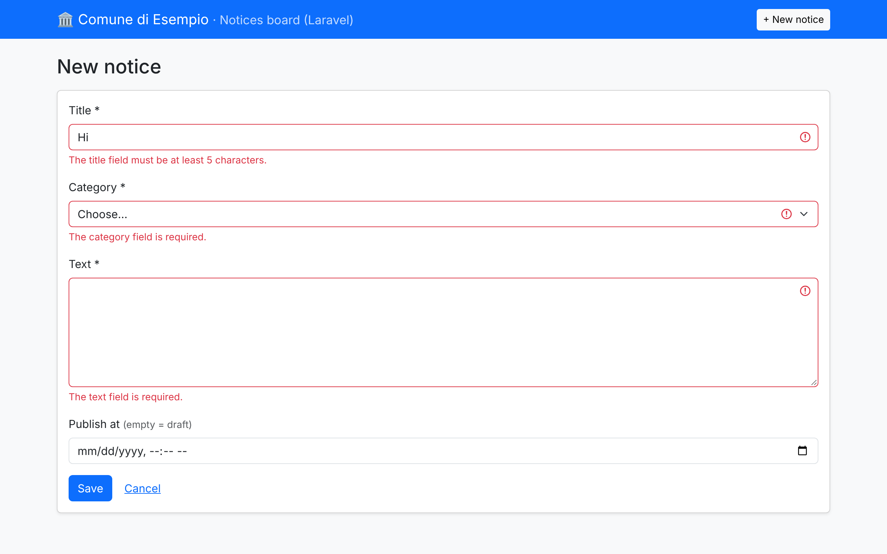

# laravel — Municipal notices board

A quick but complete tour of Laravel: a small "notices" (*avvisi*) board for a
fictional town hall, with create / read / update / delete, filtering,
validation and feature tests.



## Purpose

Learn the Laravel request lifecycle and its main building blocks, and compare
them with the plain PHP version in [`../pdo-crud`](../pdo-crud).

## Tech stack

- Laravel 13, PHP 8.3
- Eloquent ORM + migrations, factories and seeders
- Form Requests for validation, Blade components for views
- SQLite by default, MariaDB under DDEV
- PHPUnit feature tests with `RefreshDatabase`
- Bootstrap 5 via CDN (no Node build needed)

## Where to look

| Concept | File |
|---|---|
| Routes (`Route::resource`) | `routes/web.php` |
| Controller (7 REST actions, route model binding) | `app/Http/Controllers/NoticeController.php` |
| Validation (Form Request, `Rule::enum`) | `app/Http/Requests/NoticeRequest.php` |
| Model (casts, `$fillable`, scope, model event, slug route key) | `app/Models/Notice.php` |
| Enum shared by model, validation and views | `app/Enums/NoticeCategory.php` |
| Migration | `database/migrations/2026_11_05_000000_create_notices_table.php` |
| Factory + seeder | `database/factories/NoticeFactory.php`, `database/seeders/DatabaseSeeder.php` |
| Blade layout & components | `resources/views/components/`, `resources/views/notices/` |
| Tests | `tests/Feature/NoticeTest.php` |

## Run it

### With DDEV (recommended)

```bash
cd laravel
ddev start
ddev composer install
ddev artisan key:generate
ddev artisan migrate --seed
ddev launch                      # https://laravel.ddev.site
```

### Without DDEV

```bash
cd laravel
composer install
cp .env.example .env
php artisan key:generate
touch database/database.sqlite
php artisan migrate --seed
php artisan serve                # http://127.0.0.1:8000
```

### Tests and code style

```bash
php artisan test      # or: ddev artisan test
vendor/bin/pint       # Laravel's PSR-12 based code style fixer
php artisan route:list
```

## How a request flows (and why)

1. `public/index.php` boots the framework (same *front controller* idea as `pdo-crud`).
2. The router matches `GET /notices/{notice}` → `NoticeController@show`.
3. **Route model binding** turns `{notice}` into a `Notice` loaded by slug, or a 404.
4. For POST/PUT the **`NoticeRequest`** validates first; if it fails Laravel
   redirects back with `$errors` and `old()` input, so the controller only
   ever sees valid data.
5. **Eloquent** reads/writes the row; `$fillable` blocks mass-assignment of other
   columns; `casts()` converts `category` to the enum and `published_at` to Carbon.
6. **Blade** renders the view; `{{ }}` escapes output (XSS) and `@csrf` adds the
   token that the `VerifyCsrfToken` middleware checks.

## What I learned

- Laravel automates exactly what I wrote by hand in `pdo-crud`: routing, DI,
  prepared statements (query builder), escaping, CSRF, validation errors.
- Form Requests keep controllers thin; enums can be shared by DB casts,
  validation rules and views.
- Migrations + factories + `RefreshDatabase` make tests fast and repeatable.

## Screenshots

| List | Validation |
|---|---|
|  |  |
