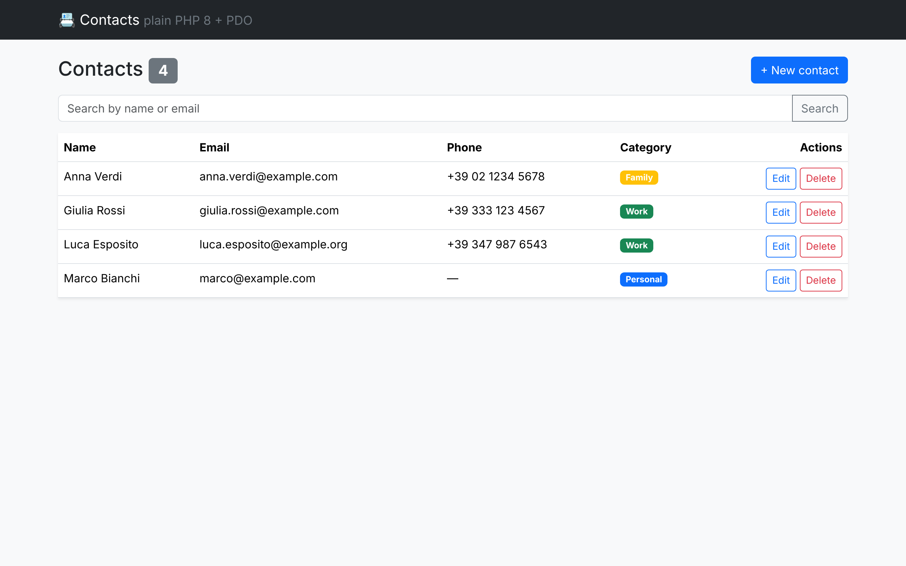
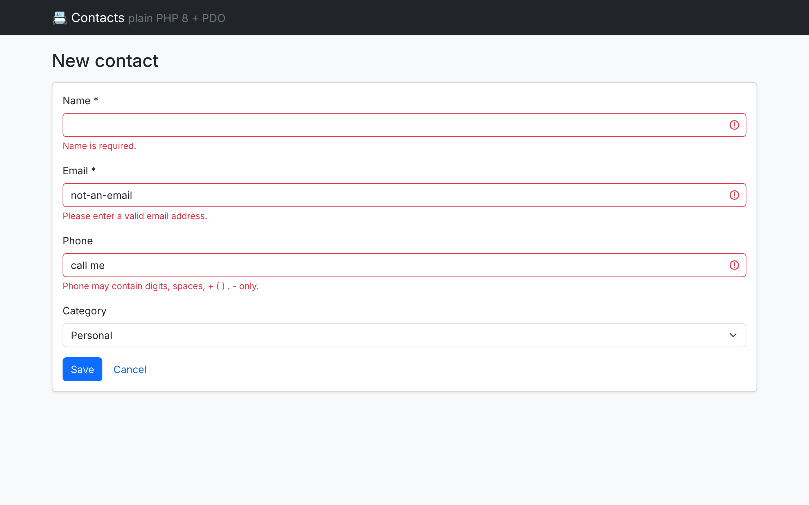

# pdo-crud — Contacts CRUD in plain PHP 8

A small contacts manager written **without a framework**, to show the
building blocks that frameworks like Laravel and Drupal are made of.



## Purpose

Practise modern PHP fundamentals end to end: database access with PDO,
Composer autoloading, PHP 8 language features, basic web security and
automated tests.

## Tech stack

- PHP 8.2+ (`readonly class`, backed `enum`, `match`, constructor promotion, named arguments)
- PDO with prepared statements — SQLite by default, MariaDB under DDEV
- Composer + PSR-4 autoloading (`App\` → `src/`)
- PHPUnit 11, PHPStan (level 8), PHP_CodeSniffer (PSR-12)
- Bootstrap 5 for the UI

## Project structure

```
pdo-crud/
├── public/index.php            # front controller: the only PHP file the web server exposes
├── src/
│   ├── Domain/Contact.php      # readonly value object
│   ├── Domain/Category.php     # backed enum + match
│   ├── Repository/             # ContactRepository interface + PDO implementation
│   ├── Validation/             # turns $_POST into a valid Contact or throws
│   ├── Http/                   # controller, CSRF helper, tiny view renderer
│   ├── Database/               # PDO factory + portable schema
│   └── Exception/              # domain exceptions (404 / 422)
├── templates/                  # plain PHP templates, every value escaped with e()
├── tests/Unit, tests/Integration
└── .ddev/config.yaml
```

## Run it

### With DDEV (recommended)

```bash
cd pdo-crud
ddev start
ddev composer install
ddev exec php bin/init-db.php   # create table + demo contacts in MariaDB
ddev launch                     # opens https://pdo-crud.ddev.site
```

Debug with Xdebug: `ddev xdebug on`, then start **"Xdebug: pdo-crud (DDEV)"**
in VS Code (config in the repo root `.vscode/launch.json`).

### Without DDEV

```bash
cd pdo-crud
composer install
composer db:init     # SQLite file in var/contacts.sqlite
composer serve       # http://127.0.0.1:8000
```

### Quality checks

```bash
composer test        # PHPUnit
composer stan        # PHPStan level 8
composer cs          # PSR-12
```

## Design decisions (why it is built this way)

- **Front controller** (`public/index.php`): one entry point, so bootstrapping
  (autoload, session, DB) happens in one place and `src/` is never web-reachable.
- **Repository interface**: the controller depends on `ContactRepository`, not on PDO.
  Storage can change and tests can use a real in-memory SQLite DB.
- **Prepared statements everywhere**: SQL and data are sent separately, so input
  can never change the query. `ATTR_EMULATE_PREPARES=false` uses native prepares.
- **Immutable `Contact`**: `readonly` means no accidental changes after validation.
- **Enum instead of strings**: `Category::tryFrom()` rejects unknown values; `match`
  must handle every case or it throws `UnhandledMatchError`.
- **Validation throws one exception with all field errors**, the controller maps
  `ValidationException` → 422 and `ContactNotFoundException` → 404.
- **Output escaping** in templates (`e()` = `htmlspecialchars`) prevents XSS;
  **CSRF token** with `hash_equals()` on every POST; **Post/Redirect/Get**
  avoids double submits.
- **Config from environment** (`DB_DSN`, `DB_USER`, `DB_PASSWORD`): no credentials in code.

## What I learned

- How Composer's PSR-4 autoloader replaces manual `require` calls.
- Why prepared statements stop SQL injection (see `testSearchIsSafeAgainstSqlInjection`).
- How PHP 8.1/8.2 features (enum, readonly) move errors from runtime to "can't even be built".
- That a framework mostly packages these same ideas: routing, DI, validation, escaping, CSRF.

## Screenshots

| List | Validation errors |
|---|---|
|  |  |
