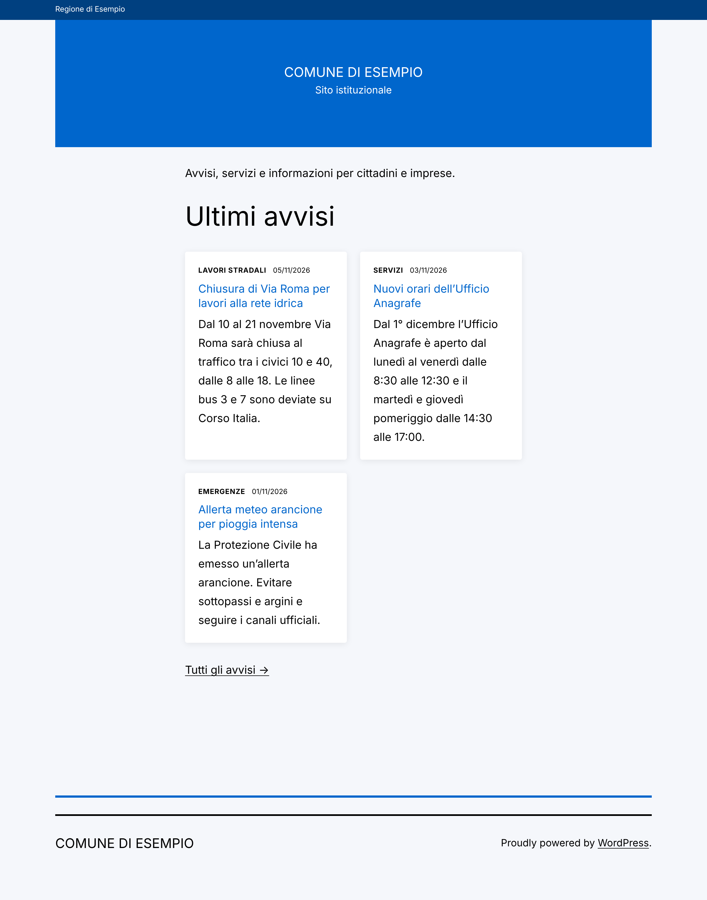
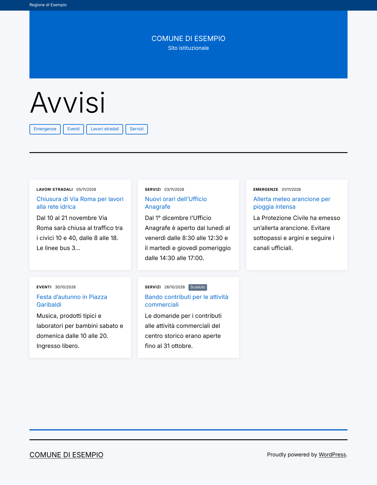
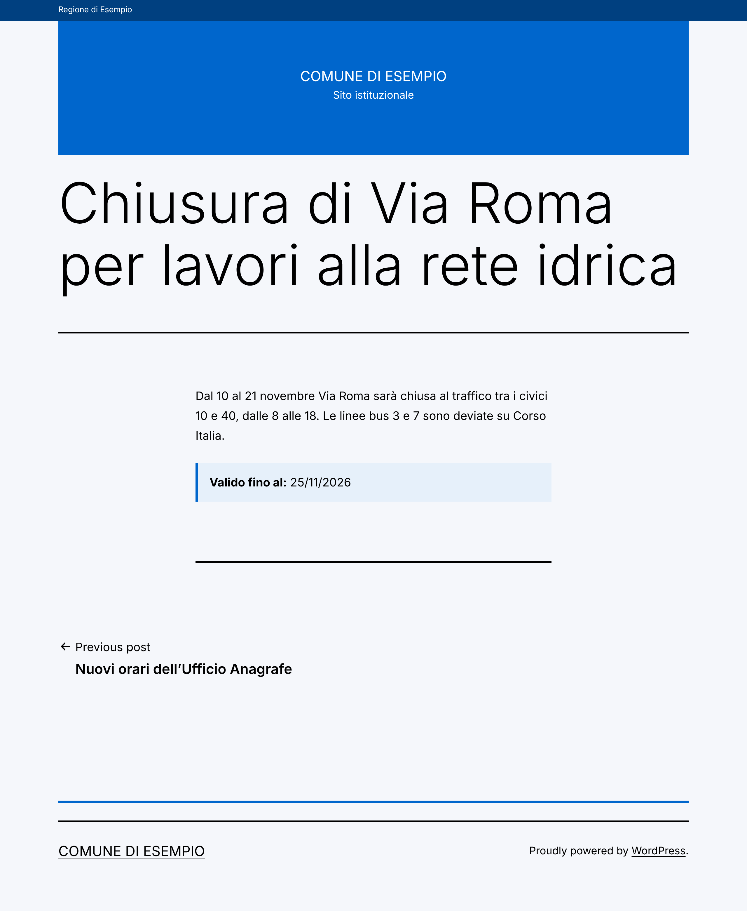
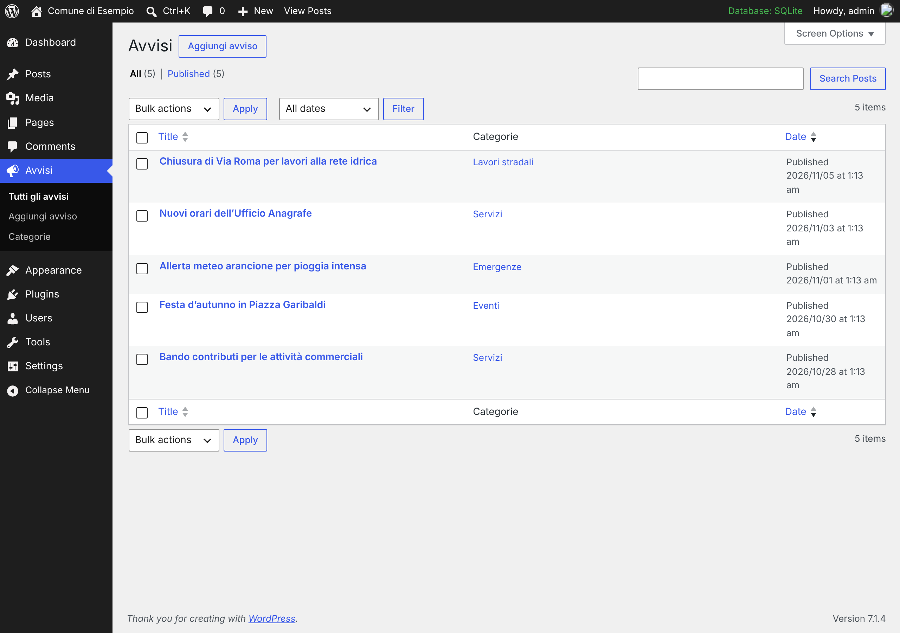

# wordpress — Child theme and plugin for a municipal website

A WordPress site for the fictional *Comune di Esempio*: a **child theme** of
Twenty Twenty-One and a **plugin** that adds notices (*avvisi*) with a custom
post type, taxonomy, meta box, shortcode, REST field and an Elementor widget.



## Purpose

Practise the WordPress way of extending a site without touching core or the
parent theme: hooks (actions and filters), the template hierarchy, custom post
types, and secure form handling (nonces, capabilities, sanitising, escaping).

## Tech stack

- WordPress 7.1, PHP 8.3
- Child theme of Twenty Twenty-One (classic PHP theme)
- Custom plugin `comune-avvisi`
- DDEV (MariaDB) — the cloud demo used the SQLite integration plugin

## What is in git

Only our code: `wp-content/themes/comune-child` and
`wp-content/plugins/comune-avvisi` (+ scripts and docs). WordPress core, other
themes/plugins, uploads and `wp-config.php` are ignored (see the whitelist
`.gitignore`).

## Run it

```bash
cd wordpress
ddev config --auto            # already configured in .ddev/config.yaml
ddev start
ddev wp core download --skip-content
ddev wp core install --url='$DDEV_PRIMARY_URL' --title='Comune di Esempio' \
  --admin_user=admin --admin_password=admin --admin_email=admin@example.com
ddev wp theme install twentytwentyone        # parent theme
ddev wp theme activate comune-child
ddev wp plugin activate comune-avvisi
ddev wp rewrite structure '/%postname%/' --hard
ddev wp eval-file scripts/demo-content.php
ddev launch
```

## Tour of the code

### Plugin `comune-avvisi`

| File | Concept |
|---|---|
| `comune-avvisi.php` | Plugin header, `ABSPATH` guard, hook wiring, activation hook that flushes rewrite rules once |
| `includes/class-post-type.php` | `register_post_type('avviso')`, `register_taxonomy('categoria_avviso')`, `register_post_meta()` with sanitize + auth callbacks, `show_in_rest` |
| `includes/class-meta-box.php` | Meta box "Valido fino al"; on save: **nonce** (CSRF) → **capability** (`edit_post`) → **sanitise** → `update_post_meta` |
| `includes/class-shortcode.php` | `[avvisi numero="3" categoria="eventi"]`: whitelisted `WP_Query` args, meta query that hides expired notices, style enqueued only when used |
| `templates/avvisi-list.php` | Output with `esc_html()`, `esc_attr()`; overridable from the theme via `locate_template()` |
| `includes/class-elementor-widget.php` | Elementor widget, loaded only on `elementor/widgets/register` |

### Child theme `comune-child`

| File | Concept |
|---|---|
| `style.css` | `Template: twentytwentyone` makes it a child theme; CSS variables override the parent palette |
| `functions.php` | Actions: `wp_enqueue_scripts`, `wp_body_open`, `pre_get_posts`; filters: `excerpt_length`, `excerpt_more`, `body_class`, `the_content`, `theme_mod_background_color`; `remove_action('wp_head', 'wp_generator')` |
| `archive-avviso.php` | Template hierarchy: `archive-{post_type}.php` is chosen before `archive.php` |

### Actions vs filters

```php
// Action: do something at a given moment. Return value is ignored.
add_action( 'wp_body_open', 'comune_child_slim_header' );

// Filter: receive a value, return it (changed or not). Always return!
add_filter( 'excerpt_length', fn ( $length ) => 25 );

// Priority (default 10) decides the order; higher runs later.
add_filter( 'excerpt_more', 'comune_child_excerpt_more', 20 );
```

### Security checklist used here

| Risk | WordPress tool |
|---|---|
| CSRF | `wp_nonce_field()` + `wp_verify_nonce()` |
| Authorisation | `current_user_can( 'edit_post', $id )` |
| Bad input | `sanitize_text_field()`, `absint()`, `sanitize_title()`, custom date validation |
| XSS | Escape late: `esc_html()`, `esc_attr()`, `esc_url()` |
| SQL injection | `WP_Query` args or `$wpdb->prepare()`, never string concatenation |

## REST API

Because of `show_in_rest`, notices are available at `/wp-json/wp/v2/avviso`
and the expiry date appears in the `meta` field.

## Elementor

See [docs/elementor.md](docs/elementor.md).

## Screenshots

| Archive /avvisi | Single notice | Admin |
|---|---|---|
|  |  |  |

## What I learned

- In WordPress everything is a hook: knowing *which* hook and *when* it runs
  (init, wp_enqueue_scripts, pre_get_posts, save_post…) is most of the job.
- A child theme + a plugin keep custom code safe from parent theme and core updates;
  content structure (CPTs) belongs in a plugin so it survives a theme change.
- Rewrite rules are order-sensitive and cached: flush them on activation, not on every request.
